# Quiet TV

**A calmer Home for Android TV, with a native procedural screensaver.**

Built for a OnePlus U1S: your apps, connected HDMI devices, now playing, a clock, and weather. No recommendations feed or advertising. Runs on the TV’s existing Android installation.

[Setup & recovery](docs/SETUP.md) · [Architecture](docs/ARCHITECTURE.md) · [MK-IV](docs/SCREENSAVER.md) · [Development](docs/DEVELOPMENT.md) · [Privacy](docs/PRIVACY.md)

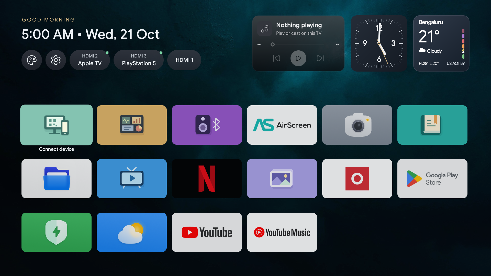

*Quiet TV 0.10.2 on a OnePlus 55U1S. HDMI 2 reports Apple TV; HDMI 3 reports PlayStation 5. Green dots indicate the connection state reported by Android.*

## Home, without the noise

| Feature | What it does |
| --- | --- |
| App grid | TV apps in your preferred order; 4, 5 or 6 columns. Hold OK to organize. |
| HDMI inputs | Connected ports appear first, with device names and corner indicators. |
| Now playing | Artwork, track information, progress and supported playback controls from Android media sessions. |
| Clock | Dark square face, accent-colored seconds hand, local time and date. |
| Weather | Bengaluru conditions, daily high/low and a vertical US AQI scale. Cached and refreshed while Home is visible. |
| Appearance | Nine wallpapers, 10-second shuffle, preset/custom accent colors and tile size. |
| Remote feedback | Gentle focus motion, captions and an original soft navigation sound. |
| Connect device | Optional local browser editor for app order, colors, backgrounds and layout backup. |
| MK-IV | Native, configurable, full-screen data-visualization screensaver. |

Use the D-pad to move, **OK** to open, **hold OK / Menu** to organize, and **Back** to dismiss. Appearance and TV settings are the first two controls. Their labels appear on focus or hover.

### A different mood for every background

| Ember | Fern |
| --- | --- |
| 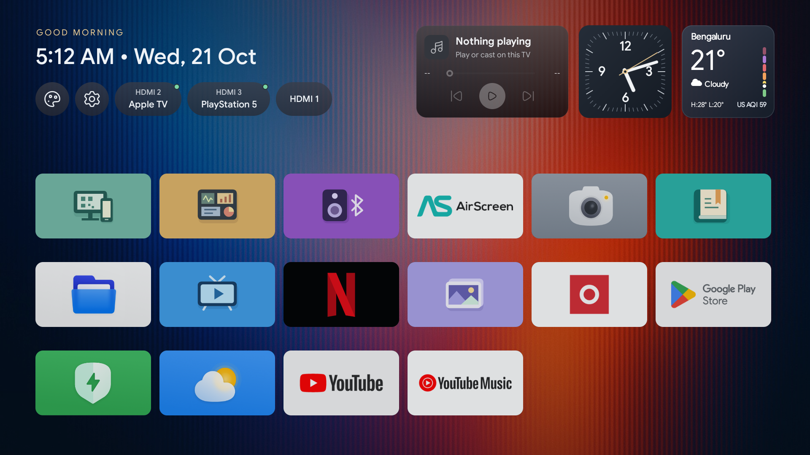 | 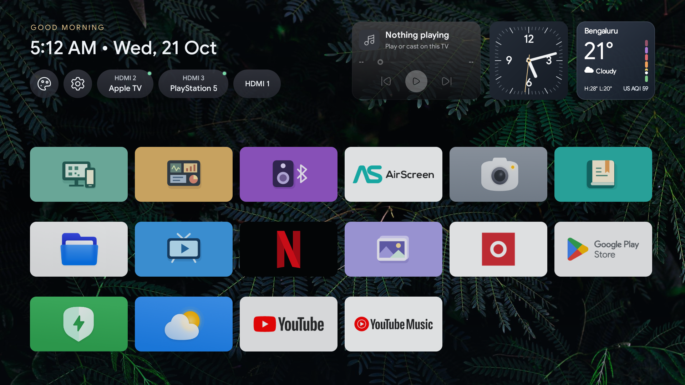 |

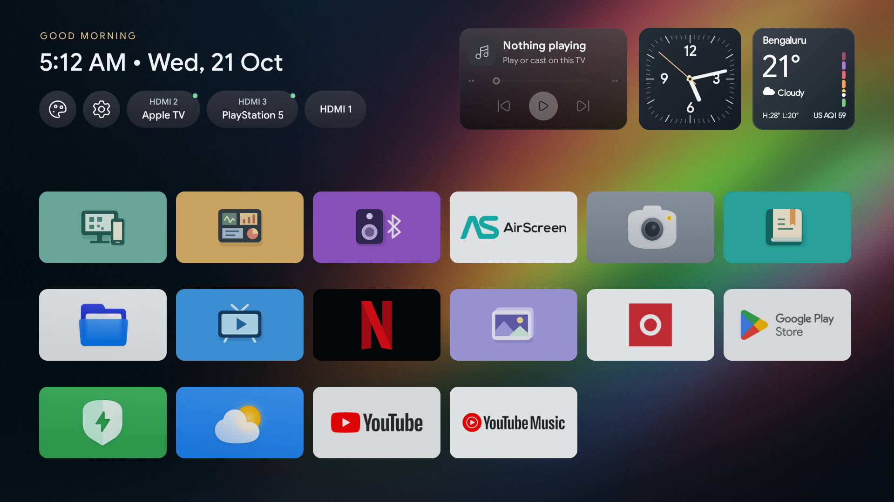

*These are full-resolution captures of the running TV app. Background photographs have separate [credits and licenses](THIRD_PARTY_NOTICES.md); app logos belong to their respective owners.*

## Make Home yours

The background gallery opens first. A persistent checkmark marks the saved choice; focus is a separate, subtle highlight. More rows peek into view so the gallery is visibly scrollable.

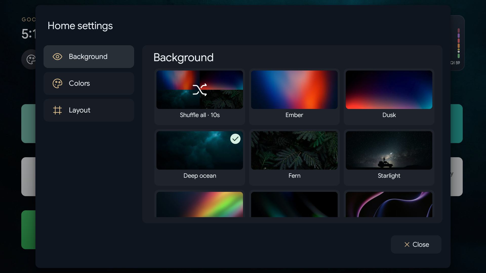

| Colors | Layout |
| --- | --- |
| 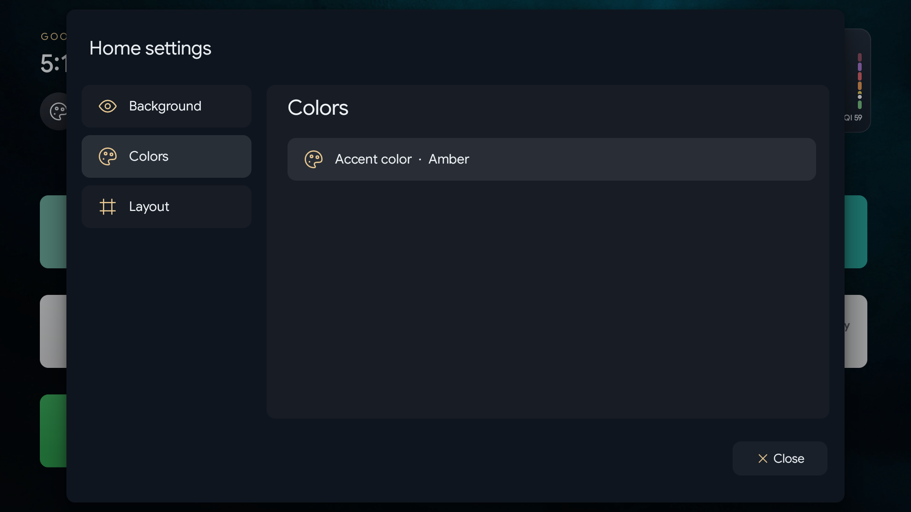 | 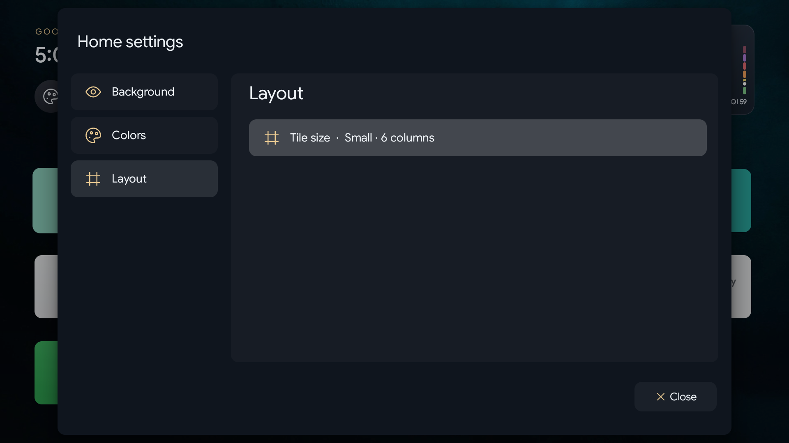 |

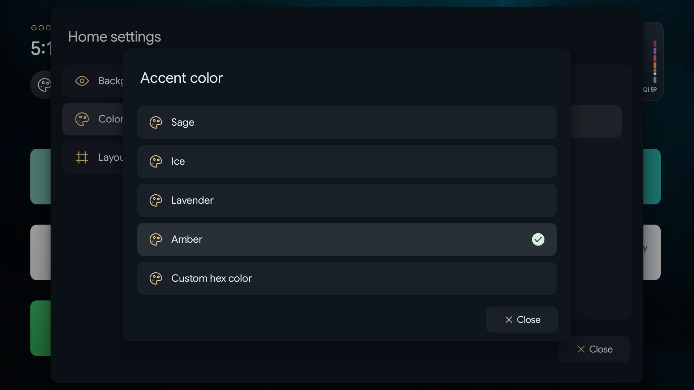

Home changes save immediately. The wallpaper stays visible behind the TV’s settings overlay; animation and background work pause while Home is inactive.

## MK-IV · Omni-data console

A native Android adaptation of my original MK-IV console: **30 visualization families, 17 palettes**, and a layout that changes color without constantly replacing its instruments. Waves, radar, gauges, terminal traces, globes and other panels are drawn directly with Canvas.

**All readings are procedural artwork.** They are not live system, financial, medical or audio measurements.

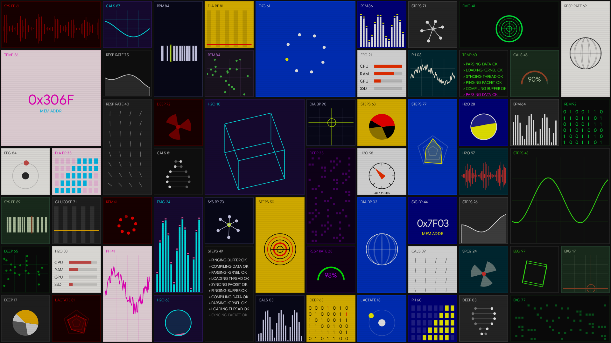

### Settings and static theme previews

Settings are grouped into Color & mood, Layout & data, Motion, Display, and System & reset. Values appear directly in each row. The embedded preview reflects the draft; **Save & apply** commits it.

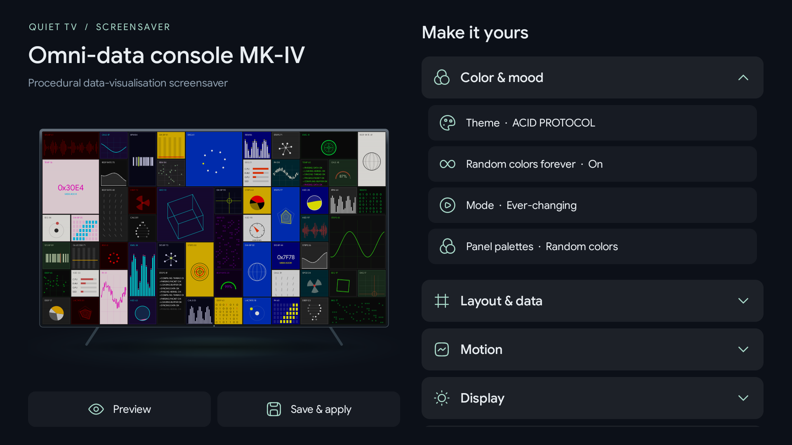

| Theme gallery | Selected theme |
| --- | --- |
| 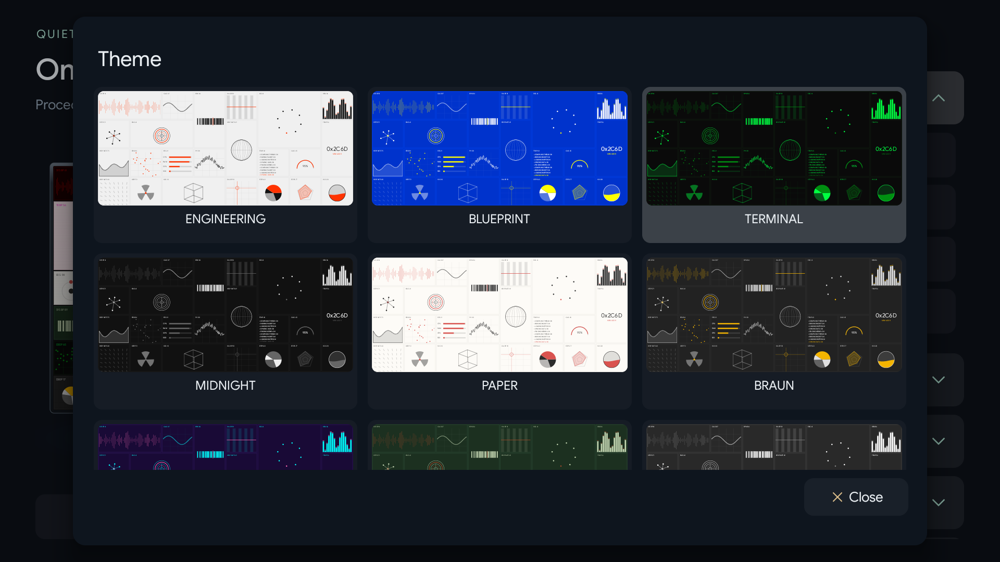 | 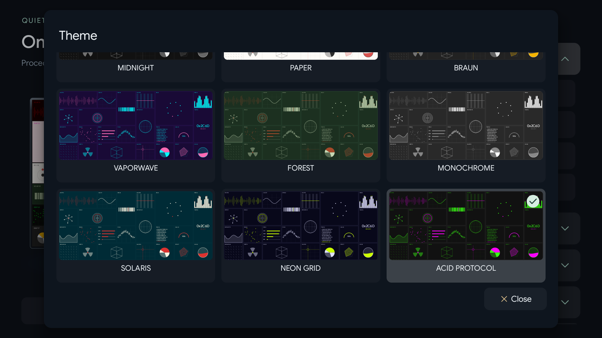 |

The theme picker uses fixed, non-animating samples for easy comparison. The full-screen preview animates the current draft without saving it.

### Full-screen designs

| Engineering | Blueprint |
| --- | --- |
| 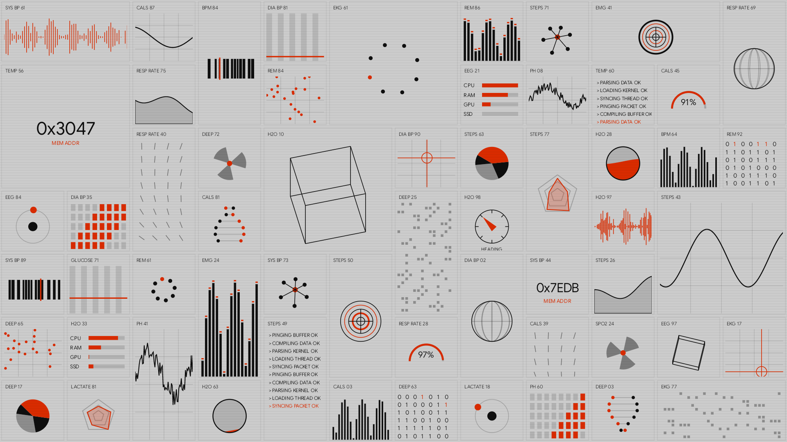 | 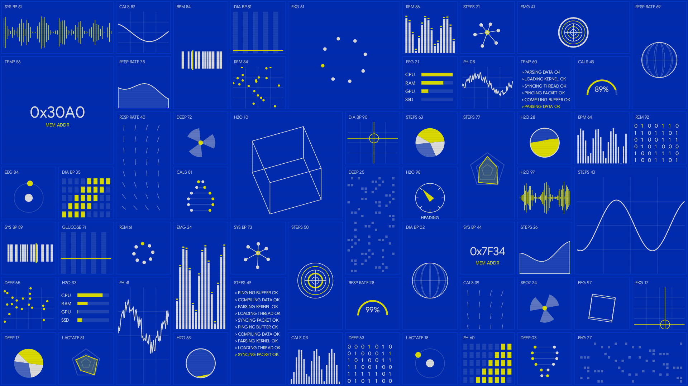 |
| **Terminal** | **Acid Protocol** |
| 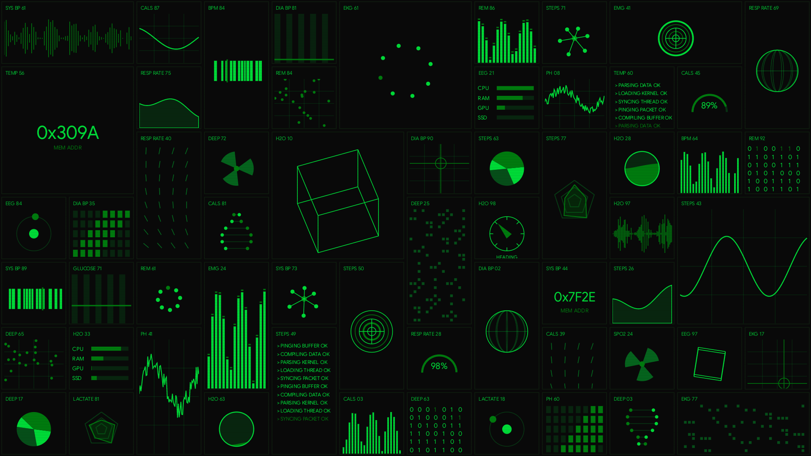 | 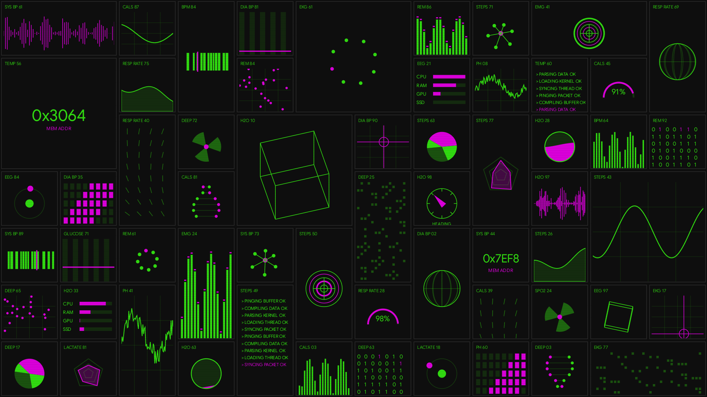 |

Choose one palette or **Random colors forever**. Customize instrument density, simulated data theme, speed, color-change interval, brightness, scanlines and a 20/30 fps limit. Color evolution and layout reshuffling are independent. [Full MK-IV guide →](docs/SCREENSAVER.md)

## How it was built

Designed by [Rahul Chakraborty](https://github.com/hckmstrrahul), with implementation and TV testing assisted by OpenAI Codex. The workflow was iterative: inspect the existing firmware, build a regular TV app, install over ADB, navigate with the remote/mirror, compare real screenshots, and refine spacing, focus, lifecycle and behavior.

- **Kotlin + Android framework Views:** no WebView or third-party UI framework.
- **Canvas:** clock, weather/AQI, backgrounds and all MK-IV instruments.
- **Platform integrations:** `TvInputManager`, `MediaSessionManager`, a notification-listener access bridge, and `DreamService`.
- **Foreground-scoped work:** decoding, weather requests, clocks and media observers stop when Home pauses. A frozen backdrop remains until Home is fully hidden.
- **Local companion:** bundled HTML/CSS/JS served by a small, bounded HTTP server. QR generation uses ZXing, the only app runtime library dependency.

[Architecture, lifecycle and data flow →](docs/ARCHITECTURE.md)

## How it replaces the TV’s Home

Quiet TV is installed as an ordinary APK. Its `.Home` activity alias registers Android’s `MAIN` / `HOME` / `DEFAULT` intent categories.

On the tested OnePlus firmware, the privileged stock Google launcher has a higher HOME filter priority, so selecting a preferred Home alone did not win. The helper first verifies that Quiet TV launches, records the original state, then **disables the stock Google launcher for user 0 only when necessary** and sets Quiet TV as Home. It verifies both the resolver and the Home key afterward.

The stock APK stays on the system partition. OxygenPlay stays enabled. No root, firmware flashing, bootloader unlock or factory reset is involved. A separate, recorded Google Recommendations workaround avoids its missing stock-Home helper during screensaver startup.

**Restore stock Home before uninstalling Quiet TV.** The scripts preserve local recovery records and provide `restore-home`; see the exact procedure in [Setup & recovery](docs/SETUP.md#restore-the-original-tv-experience).

## Build and try it

Requires **JDK 17**, Android SDK **35**, and Android platform tools. The Gradle wrapper is included.

```sh
./gradlew assembleDebug lintDebug testDebugUnitTest
```

APK: `app/build/outputs/apk/debug/app-debug.apk`.

Start with a normal app launch before changing the default Home:

```sh
export QUIET_TV_ADB_TARGET='<your-tv-address>:5555'
export QUIET_TV_SERIAL='<your-tv-serial>'
adb connect "$QUIET_TV_ADB_TARGET"
python3 scripts/tv.py verify
python3 scripts/tv.py install app/build/outputs/apk/debug/app-debug.apk
python3 scripts/tv.py launch
```

The helper deliberately accepts only the tested OnePlus model/build and your explicitly configured serial. Android TV 8.0+ is the app’s API baseline; other TVs are **not validated**. [Complete setup, permissions, screensaver selection and rollback →](docs/SETUP.md)

### Tested hardware

| Item | Verified configuration |
| --- | --- |
| TV | OnePlus 55U1S / U1S, 55-inch |
| OS | Android 11 / API 30 |
| Firmware | `RTM8.240401.135` |
| Security patch | `2024-07-01` |
| Runtime | 32-bit ARM Android; app has no native ABI libraries |
| Captures | 1920 × 1080 TV framebuffer |
| Connected sources | Apple TV on HDMI 2; PlayStation 5 on HDMI 3 |

## Validation and limits

- Debug build, **28 JVM tests**, and Android lint pass with **0 errors and 3 existing warnings**.
- On-device checks cover the media card with a controlled session, clock lifecycle, theme gallery, navigation and preservation of settings.
- HDMI discovery and names are verified; **actual input switching was not exercised**.
- Live YouTube Cast playback was intentionally skipped. Media support depends on what the playing app exposes to Android.
- Weather is currently fixed to Bengaluru. AQI uses the **US scale** and modeled Open-Meteo/CAMS data, not a nearby physical sensor.
- AirScreen and other app tiles are installed third-party apps, not bundled streaming receivers.

[Validation details](docs/VALIDATION.md) · [Network, storage and permissions](docs/PRIVACY.md)

## License and credits

Original code, documentation and original artwork/audio: **[MIT](LICENSE)**, © 2026 Rahul Chakraborty.

Bundled fonts, icons and wallpaper photographs retain their own licenses; MIT does not relicense them or third-party trademarks. See [third-party notices](THIRD_PARTY_NOTICES.md) for photographers, font/icon provenance, Gradle and ZXing credits. Weather data: [Open-Meteo](https://open-meteo.com/) and [CAMS via Open-Meteo](https://open-meteo.com/en/docs/air-quality-api).
