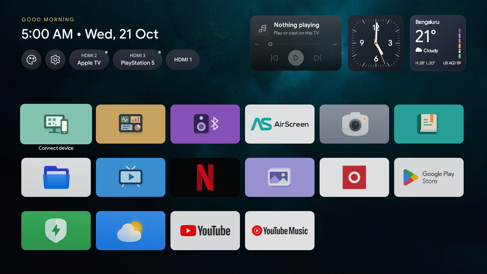
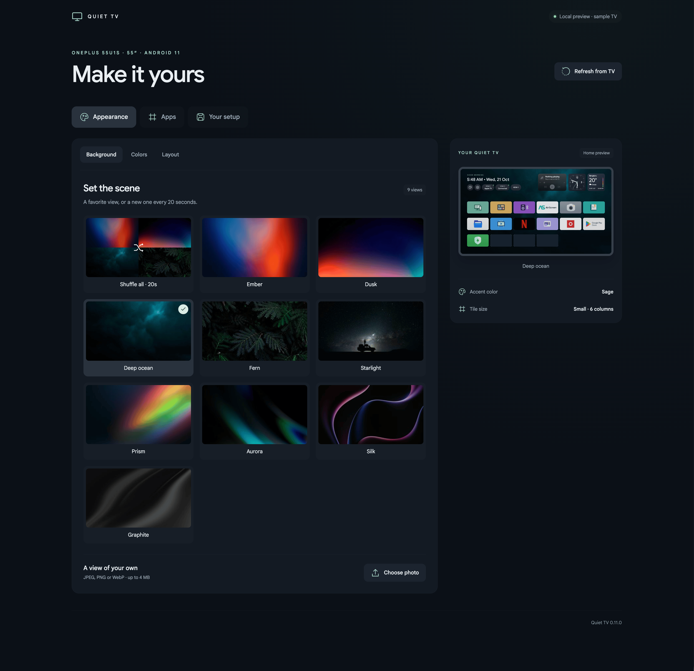
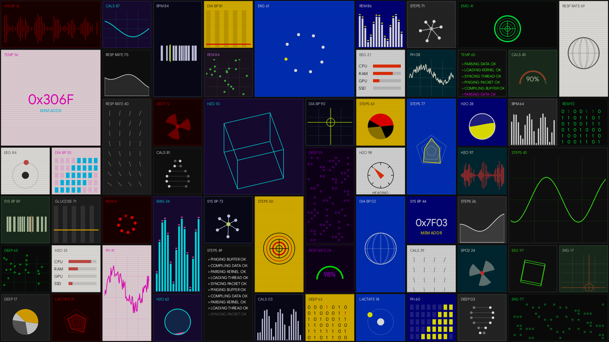

# Quiet TV

A calmer Home for Android TV, with a native procedural screensaver. Built for the OnePlus U1S: your apps, connected HDMI devices, now playing, a clock and weather, without an advertising or recommendations feed.

[Setup and recovery](docs/SETUP.md) · [Development](docs/DEVELOPMENT.md) · [Privacy](docs/PRIVACY.md)



## Make Home yours

- Arrange TV apps in four, five or six columns; hold **OK** to organize.
- See connected HDMI inputs, device names and Android media-session playback controls.
- Choose wallpapers, a 20-second wallpaper shuffle, accent colors and tile sizes.
- Adjust navigation sounds independently of media volume.
- Use the optional local browser companion to edit appearance, reorder apps and back up the layout.
- Run **MK-IV**, a native Canvas screensaver with 30 visualization families and 17 palettes.

Use the D-pad to move, **OK** to open, **hold OK / Menu** to organize and **Back** to dismiss. Home appearance changes save immediately; MK-IV settings use **Save & apply**.

## Try the companion without a TV

Requires Python 3. This preview uses sample data and keeps edits in memory.

```sh
git clone https://github.com/hckmstrrahul/quiet-tv.git
cd quiet-tv
python3 scripts/preview-companion.py
```

Open [localhost:8766](http://localhost:8766). To preview pairing, open [the pairing screen](http://localhost:8766/?pair=1) and use demo code `123456`.

The preview is not connected to a TV. For the actual companion, open **Connect device** on the TV and use its displayed address and pairing code on the same local network.



*Companion capture shows the sample-data browser editor. Home and MK-IV captures show the running Android app.*

## Build the Android app

Requires **JDK 17**, **Android SDK 35** and Android platform tools. The Gradle wrapper is included. Configure the SDK as described in [Development](docs/DEVELOPMENT.md).

```sh
./gradlew assembleDebug lintDebug testDebugUnitTest
```

The APK is written to `app/build/outputs/apk/debug/app-debug.apk`. Follow [Setup and recovery](docs/SETUP.md) to configure your device, verify its identity, install and launch the app before changing Home.

**Tested device:** OnePlus 55U1S, Android 11 / API 30, firmware `RTM8.240401.135`. Android TV 8.0+ is the app's API baseline; other TVs are not validated. The deployment helper checks the expected model, firmware and explicitly configured serial.

## Replacing and restoring Home

Quiet TV installs as an ordinary APK. On the tested OnePlus firmware, the stock Google launcher has a higher Home priority. The setup helper records the original state and, only when necessary, disables that launcher for user 0 before selecting Quiet TV. The stock APK stays on the system partition and OxygenPlay stays enabled. No root or firmware flashing is required.

**Restore stock Home before uninstalling Quiet TV.** Use the documented [`restore-home` procedure](docs/SETUP.md#restore-the-original-tv-experience). Setup also documents the recorded Google Recommendations workaround used for screensaver startup.

## MK-IV screensaver



Waves, radar, gauges, terminal traces and other instruments are procedural artwork, not live system, financial, medical or audio measurements. Configure palette, density, speed, brightness, scanlines and a 20/30 fps limit. Color changes and layout reshuffling are independent.

The native screensaver adapts [MK-IV for the web](https://mk-4-console.vercel.app/), whose [source is also available](https://github.com/hckmstrrahul/mk-4-console). See the [MK-IV guide](docs/SCREENSAVER.md) for controls and previews.

## Development and limits

Kotlin and Android framework Views provide Home; Canvas draws widgets and MK-IV. Platform APIs supply TV inputs, media sessions and `DreamService`. The companion bundles HTML/CSS/JavaScript and a local HTTP server; ZXing supplies QR generation.

- Weather is fixed to Bengaluru. AQI uses the US scale and modeled Open-Meteo/CAMS data.
- HDMI discovery and device names were verified; actual input switching was not exercised.
- Media controls depend on the playing app's Android integration.
- Third-party app tiles represent installed apps, not bundled streaming receivers.

| Guide | Covers |
| --- | --- |
| [Setup and recovery](docs/SETUP.md) | Installation, permissions, Home selection and rollback. |
| [Development](docs/DEVELOPMENT.md) | Builds, tests and companion preview. |
| [Architecture](docs/ARCHITECTURE.md) | Components, lifecycle and data flow. |
| [Validation](docs/VALIDATION.md) | Device checks and their limits. |
| [Privacy](docs/PRIVACY.md) | Network access, storage and permissions. |

## License and credits

Designed by [Rahul Chakraborty](https://github.com/hckmstrrahul), with implementation and TV testing assisted by OpenAI Codex.

Original code, documentation and original artwork/audio: **[MIT](LICENSE)**, © 2026 Rahul Chakraborty. Bundled fonts, icons, wallpaper photographs, Gradle and ZXing retain their own licenses; see [third-party notices](THIRD_PARTY_NOTICES.md). App logos and trademarks belong to their respective owners.

Weather data: [Open-Meteo](https://open-meteo.com/) and [CAMS via Open-Meteo](https://open-meteo.com/en/docs/air-quality-api).
