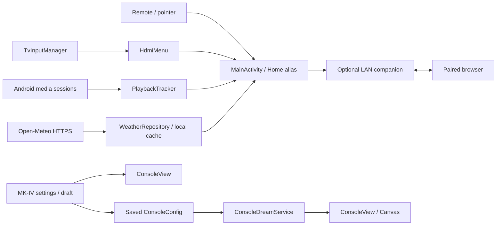

# Architecture

Quiet TV is one Android APK with three visible surfaces: Home, MK-IV settings/preview, and a system screensaver. It uses Kotlin, Android framework Views and Canvas. ZXing supplies QR encoding; no browser engine or declarative UI runtime is bundled.

## Components

| Area | Source | Responsibility |
| --- | --- | --- |
| Home | `MainActivity.kt` | TV app discovery, app order, focus routes, header, appearance and activity lifecycle |
| Wallpapers | `HomeBackdrop.kt`, `WallpaperCatalog.kt`, `WallpaperGallery.kt` | Local images, thumbnail grid, saved choice and shuffle |
| HDMI | `HdmiMenu.kt` | Fold connected CEC children into physical ports; connected-first ordering |
| Playback | `PlaybackTracker.kt`, `PlaybackMath.kt`, `MusicWidget.kt` | Session selection, metadata, progress and supported transport controls |
| Media access | `MediaAccessService.kt` | Android notification-listener authorization bridge; no notification content handling |
| Weather | `WeatherRepository.kt`, `WeatherData.kt`, `WeatherWidget.kt` | HTTPS, validation/cache, conditions and vertical AQI scale |
| Clock / feedback | `HomeTimeWidget.kt`, `TileFocusEffect.kt`, `HomeNavigationSound.kt` | Foreground clock, focus motion and short synthesized tone |
| Shared UI | `DialogUi.kt`, `SettingsAccordion.kt` | Card rows, icon/text alignment, compact actions, focus and selection |
| Companion | `CompanionEditor.kt`, `CompanionServer.kt`, `assets/companion/` | Authenticated LAN editing and local browser UI |
| MK-IV | `screensaver/` | Configuration, palette catalog, panel packing, color cycling and Canvas instruments |

Kotlin files are under [`app/src/main/java/dev/rahul/quiettv/`](../app/src/main/java/dev/rahul/quiettv/).

## Home lifecycle

`onResume` starts navigation sound resources, app/image workers, input callbacks and the current widgets. Work is scoped through `ForegroundTasks`; results from old generations cannot update a replaced view.

`onPause` stops clock ticks, sound, media observation, weather requests, wallpaper cycling, focus animations and companion networking. It closes Home dialogs. The existing wallpaper frame stays attached, so a translucent system settings overlay has a background.

`onStop` releases bitmap-backed views and clears the hidden hierarchy. This distinction fixes the earlier disappearing-wallpaper issue while avoiding continuous rendering behind video apps. Returning to Home reconstructs its views from saved preferences.

## HDMI

Android `TvInputManager` supplies physical ports, CEC child labels and connection states. `HdmiMenu` groups children under the parent, removes duplicate names and sorts connected ports first. Green dots mean **the framework reports a connected input**; they do not prove that the device is awake or outputting video.

Selection creates a passthrough-channel URI and delegates to the system TV app. On the verified firmware, the explicit channel MIME type resolves to OnePlus Live TV. Discovery is tested; actual source switching remains untested. Quiet TV does not independently issue CEC power commands.

## Playback

`MediaSessionManager` exposes active sessions after listener access is granted. The tracker chooses a relevant session and observes metadata, state, supported actions and artwork. It does not download artwork URLs or inspect notifications. Seeking and transport buttons follow the session’s capabilities; unknown times show `--`.

The widget observes Android playback, not the contents of an HDMI signal. Returning Home does not automatically stop or pause the previous player. The navigation tone is a brief SoundPool effect, not a media player or audio-focus owner. MK-IV is silent.

## Weather

The current configuration is Bengaluru (`12.9716, 77.5946`, `Asia/Kolkata`). The app requests forecast conditions/daily extremes and US AQI through two Open-Meteo HTTPS endpoints, with six-second connect/read timeouts.

Successful data is refreshed every 30 minutes while Home is active. Failures retry after five minutes. Cached readings become stale after 90 minutes and expire after six hours; invalid or excessively future-dated data is rejected. There is no background service, alarm, GPS permission or TV weather-app dependency.

AQI is modeled CAMS data on the **US AQI scale**. Six equal visual segments represent the categories, so the scale is piecewise rather than globally linear. Green/low is at the bottom; high/purple-maroon is at the top. [Open-Meteo API documentation](https://open-meteo.com/en/docs) · [Air-quality source and attribution](https://open-meteo.com/en/docs/air-quality-api).

## MK-IV rendering

`ConsoleLayout` packs a seeded grid of one- and two-cell panels. `ConsoleView` draws 30 instrument families using stable procedural noise and elapsed time. The 17-palette catalog drives single-theme and mixed-theme modes.

Color-only evolution keeps instrument identity, geometry and animation phase while blending colors. Instrument replacement and full layout reshuffling are separate options. A frame cap of 20 or 30 fps bounds updates. Render loops stop when the activity pauses or the dream detaches.

`ThemeGallery` draws all 17 themes with the same seed/layout at time zero. Its samples never start their animation loop. The settings preview pauses while the gallery is visible. Draft changes persist only through **Save & apply**.

## Persistence

Home customization, MK-IV configuration and the weather cache use separate app-private SharedPreferences. Uploaded wallpaper images stay in app-private storage. Updates with the same signing key preserve these files; clearing data or uninstalling removes them.

Android backup is disabled. Companion layout export is explicit and covers Home customization, not MK-IV or system settings. Pairing codes and bearer sessions are held in memory and destroyed when the server stops. See [privacy and security boundaries](PRIVACY.md).

## How development stayed reversible

The app was first tested as an ordinary activity. Home replacement was added only after launch/navigation worked. Device operations require an exact identity match, record the prior state, and verify the resulting resolver or setting. Screensaver selection has its own baseline and restoration path. Local diagnostic logs and recovery state are excluded from Git.

The native MK-IV renderer adapts the author’s original desktop console design for a TV: bounded grid density, remote-friendly settings, stable motion and lifecycle cancellation. It does not embed the original page in a WebView.

## Platform references

- [Android DreamService](https://developer.android.com/reference/android/service/dreams/DreamService)
- [Android MediaSessionManager](https://developer.android.com/reference/android/media/session/MediaSessionManager)
- [Android TvInputManager](https://developer.android.com/reference/android/media/tv/TvInputManager)
